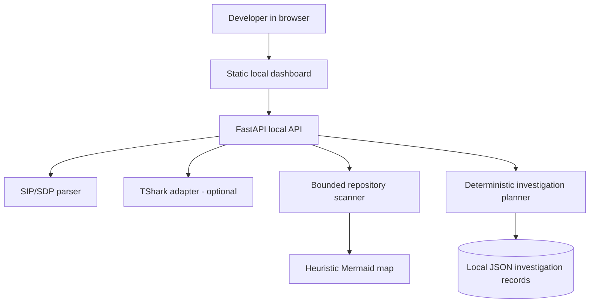

# Architecture (initial foundation)

## Current, implemented shape

This diagram describes code included in this repository. There is intentionally no external model provider or multi-agent runtime enabled in this initial version. The role catalog is a set of specialist definitions, not evidence of execution.

## Trust boundaries

- The dashboard/API is intended for a developer workstation and binds to `127.0.0.1` by default.
- The scanner reads a configured local checkout and skips secret-like files, large files, binaries, build output, and packet captures.
- PCAP analysis uses an uploaded raw byte body and invokes TShark with `shell=False`, inside a temporary directory, with size and time limits.
- Investigation records are local JSON in `DATA_DIR`; treat them as potentially sensitive if the descriptions mention incidents or customer information.
- No live network capture, phone provisioning, DB mutation, production deployment, or Kamailio reload is implemented.

## Repository-specific architecture status

`MohamedTestouri/Saylo_Platform` was observed as an empty GitHub repository during initial discovery. Therefore no actual application components, routes, schemas, or runtime edges can yet be confirmed. Set `SAYLO_REPO_PATH` to a populated local source checkout, run inventory, then validate heuristic indicators with maintainers before documenting dependencies.

## Production hardening not yet implemented

Authentication and authorization, CSRF strategy for browser sessions, multi-user tenancy, audit retention, queued job execution, robust background task management, database-backed state, model-provider integration, secrets management, CI deployment, metrics, and rate limiting.
